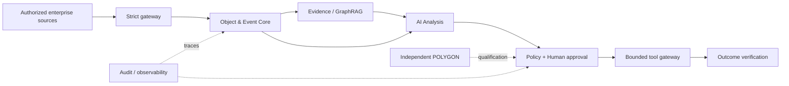

# SADEQ / FATHER — Flagship Engineering Portfolio

> **Enterprise AI Agent Engineering & Security Platform**  
> Универсальное объектно-событийное ядро для безопасных AI-агентов, управляемых действий, корпоративной интеграции и независимой квалификации.

**Статус:** ARCHITECTURE & DESIGN PORTFOLIO · PROTOTYPE IN PROGRESS · NO PRODUCTION RELEASE.  
**Дата ревизии:** 2026-11-27.  
**Контекст:** самостоятельная инженерная R&D-инициатива, интегрированная с учебной программой OTUS AI Architect. Не позиционировать как внедрённую платформу или коммерческий продукт.

## Коротко для CTO / Tech Lead
- **Задача:** избежать дублирования памяти, API, доступа и проверки безопасности при разработке специализированных AI-агентов.
- **Решение:** общая система с объектами, событиями, контрольными алгоритмами, доказательным RAG и независимым разрешением действий.
- **Ограничение:** офлайн/on-prem MVP без внешних AI API, строгие схемы сообщений и получателей, раздельные контуры квалификации и исполнения.
- **Отличие:** не просто LangChain-прототип, а контрактная архитектура `Requirement→Algorithm→Data Flow→Threat→Control→Test→Evidence`.
- **Доказательство:** в репозитории доступны IDEA+, PRD, C4/HLD, 12 алгоритмов, SEDA, 100 проектных угроз, ADR и подготовка ГОСТ-ориентированного комплекта. **Полномасштабной реализации, независимых испытаний и производственных KPI пока нет.**

## Ключевая архитектура

## Что покажем работодателю
| Компетенция | Артефакт | Статус |
|---|---|---|
| Enterprise architecture | C4, system context/container, 8 блоков, ADR | DOCUMENTED |
| LLM/RAG engineering | GraphRAG architecture, sources, evaluation plan | DESIGNED |
| AI agent orchestration | ALG-01…ALG-12, states, bounded actions | DESIGNED |
| Application security | UAG, Contract-Strict, TOP-100 threats, negative tests | DESIGNED; TESTS_NOT_RUN |
| SDLC and qualification | SEDA, POLYGON gates, qualification contracts | DESIGNED |
| DevSecOps/K8s | 12-factor mapping, deployment options, manifest template | DESIGNED |
| Standards and delivery | ГОСТ 34 / ЕСПД documentation register, OTUS traceability | DOCUMENTED PLAN |
| Commercial maturity | Customer interviews, pilots, production metrics | NOT CONFIRMED |

## Обязательные ссылки на исходные доказательства
- [IDEA+](../IDEA_PLUS_V0_2/01_IDEA_CONTRACT.md)
- [Product baseline](../PRODUCT_BASELINE_V1/00_PRODUCT_DOCUMENT_REGISTER.md)
- [HLD/C4](../PRODUCT_BASELINE_V1/HLD_V01/README.md)
- [12 agent algorithms](../PRODUCT_BASELINE_V1/BUSINESS_AGENT_V01/05_ALGORITHMS_DETAILED_SPECIFICATION.md)
- [SEDA book-backed algorithm selection](../PRODUCT_BASELINE_V1/ENGINEERING_ALGORITHM_V1/README.md)
- [Threats 100 + Secure SDLC](../PRODUCT_BASELINE_V1/SECURE_SDLC_TOP100_V1/README.md)
- [API design v0.1 and known contract gaps](../PRODUCT_BASELINE_V1/API_DESIGN_V01/FATHER_CONTRACT_STRICT_ADOPTION.md)
- [Kubernetes / Twelve-Factor](../PRODUCT_BASELINE_V1/K8S_12_FACTOR_V01/README.md)
- [ГОСТ-ориентированная система документов](../PRODUCT_BASELINE_V1/GOST_ENGINEERING_DOC_SYSTEM_V01/README.md)

## Материалы флагманского кейса
- [Интерактивная визуальная презентация/лендинг (исходник HTML)](index.html) — для локального просмотра или последующей публикации с отдельным разрешением.
- [Блок резюме, кейс и речь для интервью](RESUME_CASE_RU.md)
- [Дизайн-система и карта презентации](VISUAL_AND_EVIDENCE_STANDARD.md)

## Резюме / этика доказательств
Честно писать **«разрабатываю архитектуру и прототип»**, **«подготовил проектные документы»**, **«прорабатываю безопасные алгоритмы»**. Пока нет независимых E2E-test reports, не писать «внедрил», «запустил в production», «сертифицировано» или «доказано безопасно».
