# IDEA+ — SADEQ Enterprise Operations Copilot
**ID:** IDEA-2026-SADEQ-003 · **Редакция:** 0.3 · **Дата:** 2026-11-27 · **Статус:** PROPOSED / NOT APPROVED.

## 0. Решение об изменении базовой концепции
Предыдущая IDEA+ v0.2 сохраняется как исследовательский исходник. Новый объект проектирования — **один корпоративный агент технических заявок и регламентов** на универсальном UAA ядре. Фабрика множества агентов остаётся будущим развитием, а не условием первого релиза. Приоритеты изменены после [анализа вакансий, 27.11.2026](../MARKET_DRIVEN_MVP_2026_11/README.md). Изменение не означает фактического завершения предыдущих документов.

## 1. Идея и бизнес-проблема

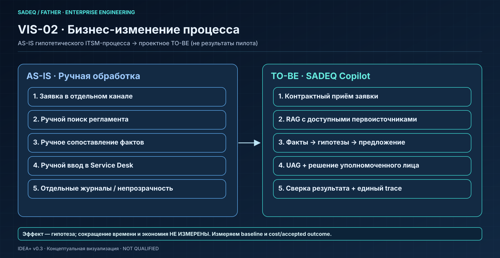

*Рисунок VIS-02 — AS-IS → TO-BE: гипотеза преобразования обработки заявки. SADEQ IDEA+ v0.3; проектная визуализация, не результат испытаний.*

Корпоративные операторы тратят время на поиск регламентов, анализ заявок, сопоставление событий и ручное перенесение предложений в Service Desk/ERP. Непрозрачные LLM-решения без разделения полномочий создают риск утечки данных, ошибочного действия и невозможности доказать результат. Нужен локальный помощник, который **обоснованно предлагает**, а действуют только разрешённые инструменты после политик и согласования.

## 2. Заинтересованные стороны и потребители

### 2.1. Целевой корпоративный горизонт установки (решение для проектирования)
**Подразделение:** внутренняя ИТ-служба крупной организации, Service Desk L1/L2 и инженеры сопровождения ИС. **Размещение:** локальный серверный контур с границами Z0–Z7; вход — заявки и утверждённые регламенты; выход — цитируемая рекомендация, типизированный черновик изменения заявки, согласование и проверка результата в mock ITSM. Реальный заказчик и продуктивный сервер не выбраны; первая установка — локальная лаборатория на синтетических данных. [Паспорт целевого размещения](05_ENTERPRISE_DEPLOYMENT_HORIZON.md).

### 2.2. Какие знания и алгоритмы подготавливаем
Материалы: каталог услуг/SLA, SOP/регламенты, известные ошибки, синтетические инциденты, объекты ИС, OpenAPI mock ITSM, ACL и политики, source manifest, эталонные и атакующие сценарии. Алгоритмы: ALG-01…08, ALG-10…12 в P0; ALG-09 — только при наличии данных (P2). P1 — реальный GraphRAG с путями и тремя профилями. [Матрица 14 классов материалов](06_AGENT_KNOWLEDGE_CURRICULUM.md).

### 2.3. Программа подготовки и экзамен агента
Движение по уровням L0–L8: схемы и права → классификация → цитаты → гипотезы → предложение → human approval → восстановление и отказ → новые профили → graph reasoning. Независимые проверки Q00–Q11: права на корпус, контракты, события, retrieval, LLM, безопасность действий, бизнес-результат, adversarial regression, offline, E2E, POLYGON, human release. **Веса LLM не обучаем в P0; RAG-индексация и настройка workflow не равны fine-tuning.** [Программа квалификации](07_AGENT_TRAINING_AND_QUALIFICATION.md).

**Бизнес-пользователь:** инженер поддержки/оператор ITSM; **владелец данных:** контролирует источники и классификацию; **согласующий:** подтверждает точно сформированное изменение заявки; **администратор:** настраивает контур; **ИБ/SOC:** контролирует риски; **независимый экзаменатор:** POLYGON.
**Бенефициар проекта:** автор и инженерное портфолио для AI Engineer/AI Security/Enterprise Integration, а также OTUS AI Architect. Реальный коммерческий заказчик, бюджет и измеренный ROI не подтверждены.

## 3. Проверяемая ценность
Сократить ручное переключение между заявкой, документом и системой исполнения *как гипотеза*. Демонстрация обязана показать: входная заявка → цитаты из локальной БЗ → объяснимое предложение → проверка разрешений → согласование → запись в тестовую ITSM → независимая проверка состояния. Обещания экономии времени и качества запрещены до измерения baseline.

## 4. Утверждаемые цели и границы по фазам

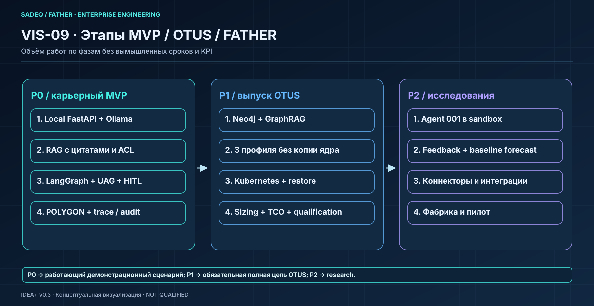

*Рисунок VIS-09 — План развития: P0 MVP, P1 OTUS, P2 FATHER. SADEQ IDEA+ v0.3; проектная визуализация, не результат испытаний.*

### P0 — Карьерный MVP (первый сквозной работающий сценарий)
- Локальный inference без внешних AI API, FastAPI, PostgreSQL, Qdrant, контейнеризация и воспроизводимый запуск.
- Вход через API и загрузку документа; схема должна быть закрытой и версионированной.
- Импорт двух форматов (PDF и DOCX) из разрешённого синтетического набора, provenance/chunk IDs.
- RAG с видимыми цитатами на первоисточники, tenant ACL до выдачи содержимого, benchmark against lexical/vector baseline.
- Управляемый LangGraph-orchestrated workflow с checkpoint/retry/limits.
- UAG/Policy enforcement вне LLM; строго типизированный mock Service Desk tool; human approval для изменения заявки.
- Регистрация события, состояние, дедупликация, post-action verification.
- POLYGON как независимый исполняемый тестовый контур: функциональные, негативные, регрессионные, security-тесты, evidence.
- Наблюдаемость/метрики и демонстрационный веб-интерфейс.
### P1 — Итоговая OTUS-квалификация
- Реальный Neo4j GraphRAG с проверяемыми путями отношений и сравнением с vector-only.
- Три декларативных профиля на одном ядре для доказательства повторного использования (можно запускать на синтетических сценариях).
- K8s deployment, backup/restore, испытания offline/tenant-boundaries, measured sizing and TCO.
- Более строгий full SDLC и документационные комплекты, представление для комиссии.
### P2 — Research / future
- Agent 001 generates patch+tests in sandbox (не сам себя выпускает).
- Управляемое обновление знаний по feedback, прогнозирование при достаточной истории, более широкие коннекторы 1С/Bitrix24/n8n/MCP, обучение/адаптация моделей.
- Масштабирование фабрики/коммерческая продажа — только после пилота.

## 5. Что сознательно НЕ делаем в P0
Автономные высокорисковые операции, платежи, медицинский диагноз, эксплуатация реальных пациентских данных, облачные модельные API, обучение весов LLM, 20 агентов, обещание 10 000 LLM RPS, подтверждение сертификации или соответствия требованиям Минобороны, не имея договорных оснований.

## 6. Список желаемого → жёсткие ограничения

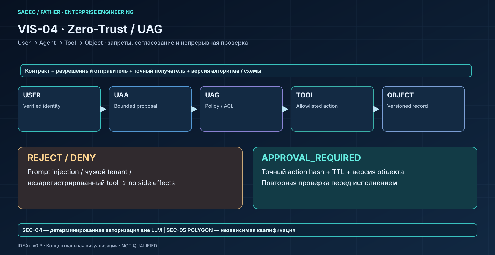

*Рисунок VIS-04 — Zero Trust, границы полномочий, UAG и согласование. SADEQ IDEA+ v0.3; проектная визуализация, не результат испытаний.*

| ID | Driver | Тип | Решение |
|---|---|---|---|
| WD-01 | реальная корпоративная польза | желаемое | end-to-end заявка→решение→подтверждение |
| WD-02 | локальный, reproducible | обязательное P0 | deny egress, approved model artifacts |
| WD-03 | доказательный RAG | обязательное P0 | source/chunk/version citations |
| WD-04 | безопасные действия | обязательное P0 | allowlisted tool, separate policy, approval |
| WD-05 | воспроизводимость | обязательное P0 | events, checkpoints, ledger |
| WD-06 | качество | обязательное P0 | golden eval + negative suite |
| WD-07 | доказательство LLM/agent competencies | обязательное P0 | code, traces, results, demo |
| WD-08 | graph relationships | OTUS P1 | Neo4j graph path + measured comparison |
| HC-01 | запрет внешних LLM API | HARD | on-prem + egress-deny |
| HC-02 | запрет чтения чужих tenant данных | HARD | policy in retrieval/graph/cache/log |
| HC-03 | запрет agent self-approval и критических tool calls | HARD | independent deterministic controls |
| HC-04 | контракт-строгий поток | HARD | closed schemas, recipients, algorithm binding |
| HC-05 | никакой QUALIFIED без evidence | HARD | POLYGON, human release decision |
| HC-06 | реальный рабочий baseline должен укладываться в локальную лабораторию | HARD в лаборатории | Nvidia RTX3060 12GB / 32GB RAM; модель и throughput только после benchmark |

## 7. Пользовательские истории

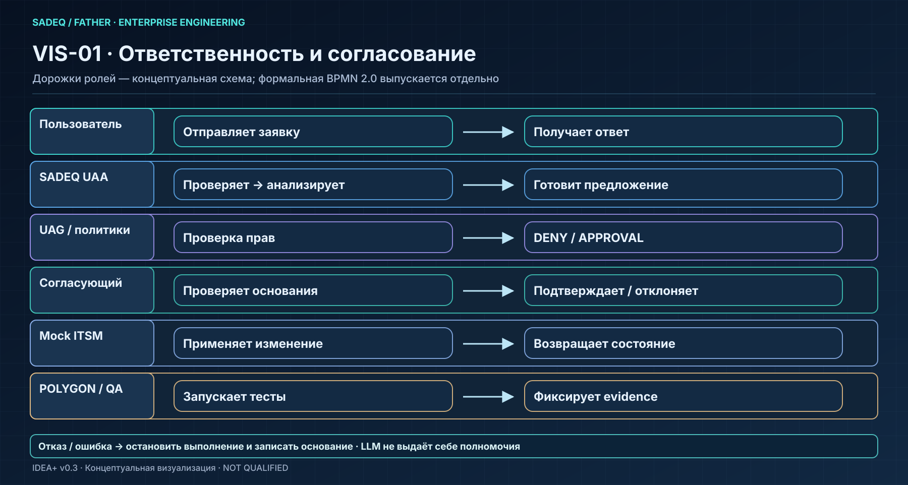

*Рисунок VIS-01 — Дорожки ответственности: оператор, агент, UAG, согласующий, ITSM, POLYGON. SADEQ IDEA+ v0.3; проектная визуализация, не результат испытаний.*

| ID | История | Проверяемое завершение |
|---|---|---|
| US-01 | Инженер подаёт инцидент | trace+immutable event |
| US-02 | Инженер спрашивает регламент | цитата и ссылка на разрешённый фрагмент |
| US-03 | Агент предлагает исправление заявки | типизированный draft+source evidence |
| US-04 | Согласующий одобряет/отклоняет действие | точные параметры, время, actor, decision |
| US-05 | Владелец видит результат | подтверждённый authoritative ITSM state |
| US-06 | ИБ пытается выполнить запретный запрос | deny+audit без утечки |
| US-07 | Экзаменатор запускает оценку и регрессию | evidence с hash/version/expected/actual |
| US-08 | Архитектор объясняет tradeoff | ADR с альтернативами и измерениями |

## 8. Бизнес-схема

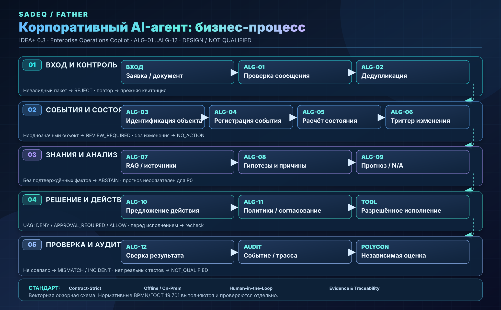

> **Рисунок IDEA-BPM-01 — Основной бизнес-процесс SADEQ UAA (обзорная архитектурная инфографика, версия 0.3).**  
> [Открыть схему отдельно в полном размере](diagrams/SADEQ_BUSINESS_FLOW_V03.svg). Статус: **спроектировано / не квалифицировано**. Фирменная визуализация не является формальной BPMN 2.0 или схемой алгоритма по ГОСТ 19.701-90.

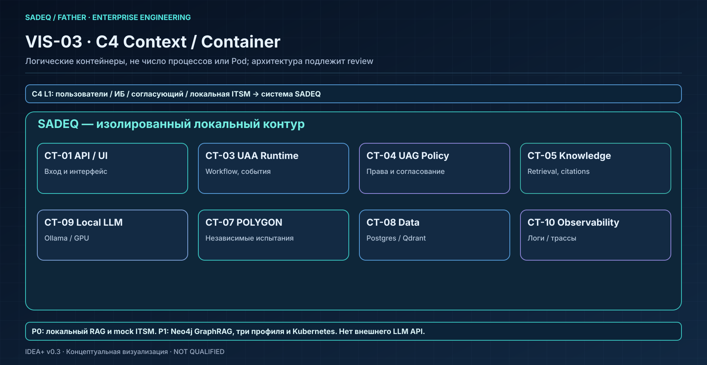

*Рисунок VIS-03 — C4 — контекст и логические контейнеры в локальном контуре. SADEQ IDEA+ v0.3; проектная визуализация, не результат испытаний.*

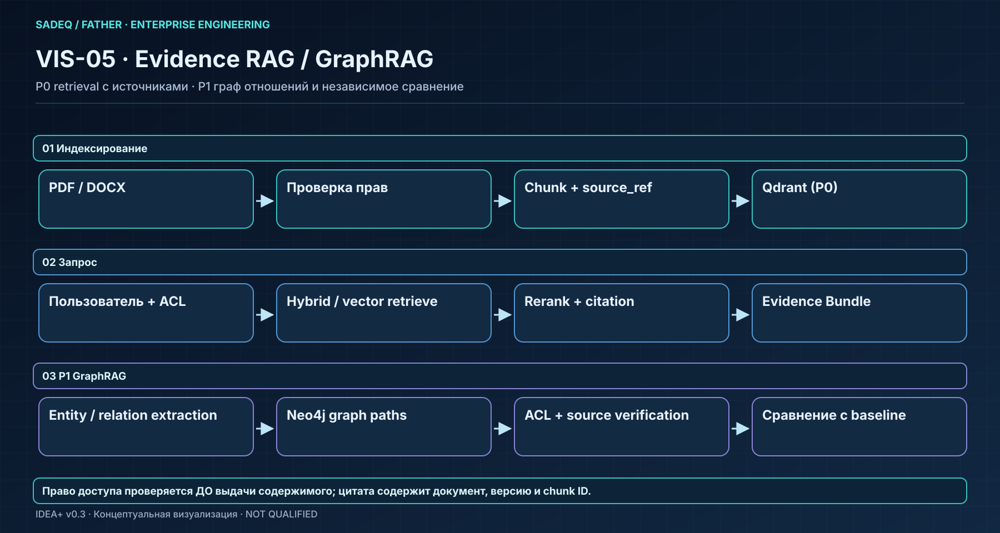

*Рисунок VIS-05 — Потоки знаний: RAG P0 и GraphRAG P1. SADEQ IDEA+ v0.3; проектная визуализация, не результат испытаний.*

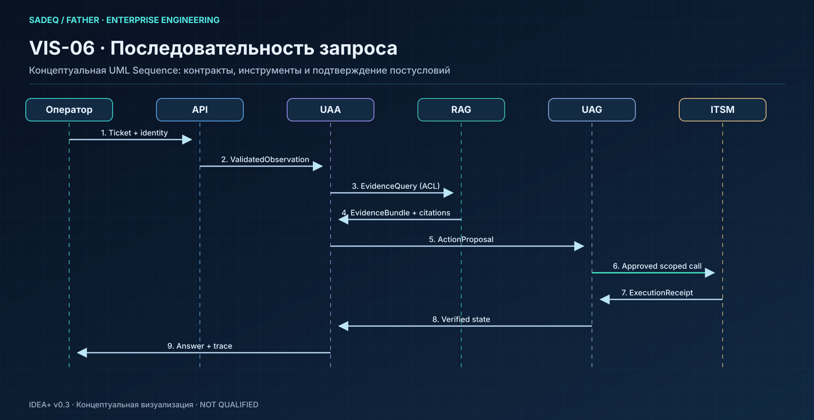

*Рисунок VIS-06 — Последовательность запроса и обмен информационными контрактами. SADEQ IDEA+ v0.3; проектная визуализация, не результат испытаний.*

**Машинно-проверяемая последовательность (текстовая альтернативная версия):**  
`Authenticated ticket/document → ALG-01 validate → ALG-02 dedupe → ALG-03 object identity → ALG-04 event append → ALG-05 state → ALG-06 trigger → ALG-07 evidence retrieval → ALG-08 hypotheses → ALG-09 forecast if supported (else NOT_AVAILABLE) → ALG-10 policy-bound proposal → ALG-11 authorization/human → tool → ALG-12 authoritative verification → audit/review`.

**Ветки бизнес-решений:** `REJECT` — запрет при нарушении контракта; `REVIEW_REQUIRED` — неоднозначный объект; `NO_ACTION` — нет значимого события; `ABSTAIN` — недостаточно фактов; `NOT_AVAILABLE` — нет обоснованного прогноза; `APPROVAL_REQUIRED` — действие ждёт уполномоченного человека; `MISMATCH` — результат инструмента не подтверждён бизнес-системой. Все решения, за исключением оформления объяснения, проверяются детерминированными контролями.

### 8.1. Реестр выпущенных иллюстраций IDEA+ v0.3

| Номер | Иллюстрация | Артефакт | Статус |
|---|---|---|---|
| VIS-01 | Дорожки участников | [SVG](diagrams/VIS-01_SWIMLANES.svg) | DRAWN / DESIGN, не подтверждено испытаниями |
| VIS-02 | AS-IS / TO-BE | [SVG](diagrams/VIS-02_AS_IS_TO_BE.svg) | DRAWN / DESIGN, не подтверждено испытаниями |
| VIS-03 | C4 архитектура | [SVG](diagrams/VIS-03_C4_CONTEXT_CONTAINER.svg) | DRAWN / DESIGN, не подтверждено испытаниями |
| VIS-04 | UAG / Zero Trust | [SVG](diagrams/VIS-04_ZERO_TRUST_UAG.svg) | DRAWN / DESIGN, не подтверждено испытаниями |
| VIS-05 | RAG / GraphRAG | [SVG](diagrams/VIS-05_RAG_GRAPHRAG.svg) | DRAWN / DESIGN, не подтверждено испытаниями |
| VIS-06 | Sequence | [SVG](diagrams/VIS-06_SEQUENCE.svg) | DRAWN / DESIGN, не подтверждено испытаниями |
| VIS-07 | Traceability / Gates | [SVG](diagrams/VIS-07_TRACEABILITY_GATES.svg) | DRAWN / DESIGN, не подтверждено испытаниями |
| VIS-08 | Данные и события | [SVG](diagrams/VIS-08_DATA_EVENTS.svg) | DRAWN / DESIGN, не подтверждено испытаниями |
| VIS-09 | Фазы MVP | [SVG](diagrams/VIS-09_MVP_ROADMAP.svg) | DRAWN / DESIGN, не подтверждено испытаниями |
| VIS-10 | Sizing / FinOps | [SVG](diagrams/VIS-10_SIZING_FINOPS.svg) | DRAWN / DESIGN, не подтверждено испытаниями |

**Формальная нотация:** VIS-01 — обзор дорожек, не BPMN 2.0 XML; VIS-03 — C4-подобная обзорная схема, не полная формальная модель C4; VIS-06 — обзор сообщений, не UML-совместимый исходник; алгоритмические схемы ГОСТ 19.701 требуют отдельного оформления. **VIS-10 не содержит выдуманных замеров.**

**Стандарт визуального оформления:** единый SADEQ/FATHER navy/cyan/violet, читаемые названия, номер рисунка и версия, источники/трассировка, статус фактических доказательств, редактируемый SVG/Mermaid или BPMN-исходник, проверка ошибок и доступность подписи. Официальный документ по ГОСТ выпускается в отдельной проверенной форме, а не заменяется инфографикой.

## 9. Нефункциональные свойства и риски

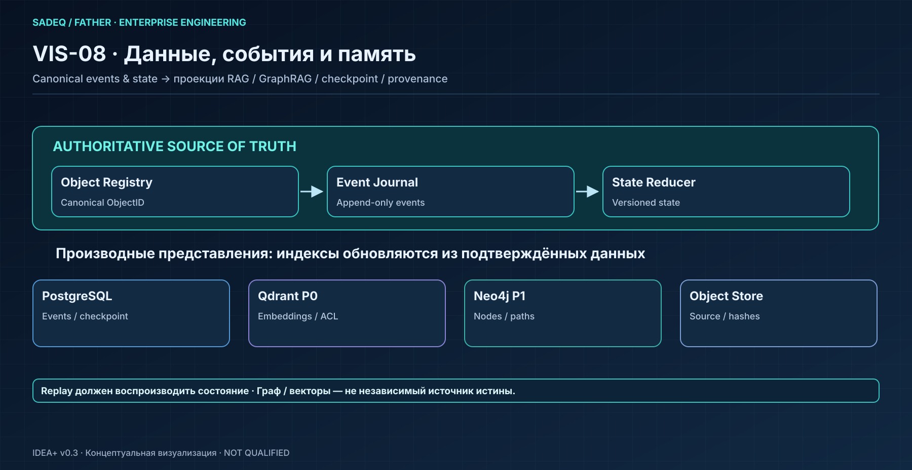

*Рисунок VIS-08 — Архитектура состояния, событий, PostgreSQL, Qdrant и Neo4j. SADEQ IDEA+ v0.3; проектная визуализация, не результат испытаний.*

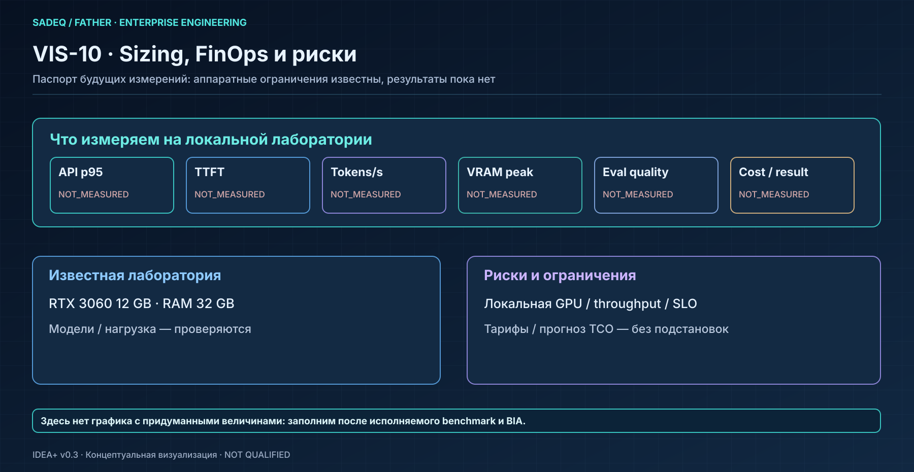

*Рисунок VIS-10 — Паспорт будущих измерений sizing, FinOps и рисков. SADEQ IDEA+ v0.3; проектная визуализация, не результат испытаний.*

**Security:** strict ACL, source provenance, prompt injection refusal, offline. **Reliability:** replay and idempotency. **Observability:** p95, TTFT, tokens/s, peak VRAM, trace/metrics; числа устанавливаем на baseline и измеряем. **Maintainability:** typed APIs, ADR, human commits, signed releases, SBOM and documented change control. **Data:** synthetic, rights-cleared, retention documented. **Risks:** cross-tenant leak, hallucination, wrong tool action, denial by local GPU, graph-index quality; threat matrix grows from IDEA+.

## 10. Успех и прекращение работы

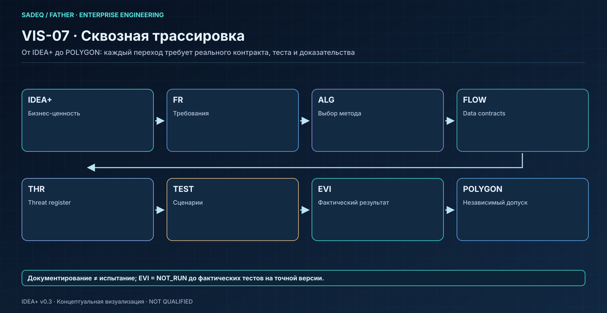

*Рисунок VIS-07 — Сквозная трассировка от IDEA+ до независимых доказательств. SADEQ IDEA+ v0.3; проектная визуализация, не результат испытаний.*

P0 PASS только при работающем полном маршруте и сохранённых независимых evidence в целевой лаборатории. При незакрытом критичном тесте или несанкционированном tool call — NO-GO. При невозможности достижения качества RAG — пересмотреть retrieval, не «улучшать» отчёт. Product-market fit не заявляем до реальных интервью и пилотов.

## 11. Обоснование научно-инженерного выбора
- Gough/Bryant/Auburn *Mastering API Architecture*: C4, ADR, OpenAPI, contract tests.
- Suhas Pai *Designing Large Language Model Applications*: embedding/retrieval/reranking/GraphRAG.
- Antonio Gulli *Agentic Design Patterns*: routing, planning, tool use, checkpoints/memory.
- Chip Huyen *AI Engineering*: practical AI system evaluation, model choices and failure modes (точные главы проверять для каждого решения).
- Kubernetes Patterns: deployment research and benchmarking after P0.
Все решения оформляются как `SRC→ALG→PAT→ADR→TEST`, без выдачи книжной методики за подтверждённый результат.

## 12. Отличия новой редакции
Первый рабочий релиз перестал зависеть от 20 агентов, полной фабрики и прогнозов; реальный GraphRAG и три профиля перенесены в обязательный этап OTUS P1; независимость UAG и POLYGON сохранена; текущий карьерный результат — отдельный измеряемый сценарий Enterprise Operations Copilot.

**Следующий документ:** [ТЗ на АС по ГОСТ 34.602-2020](02_TECHNICAL_ASSIGNMENT_GOST_34_602.md).
