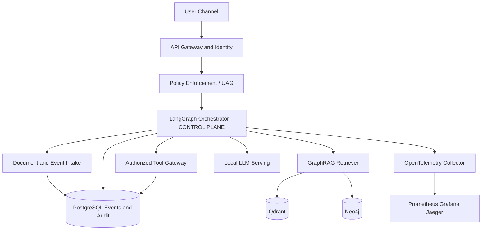
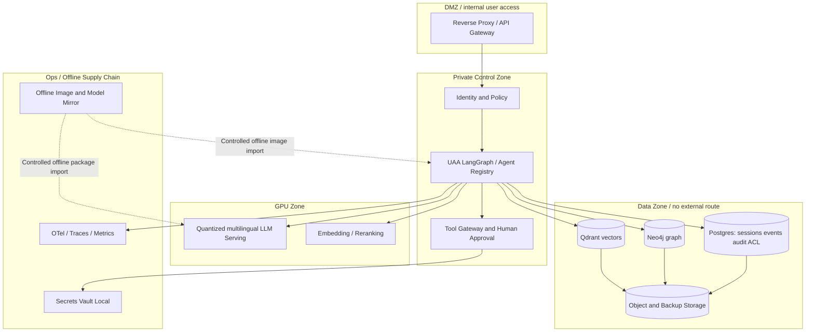

# DEPLOY-001 · Deployment & Scaling Architecture SADEQ UAA
**v0.3 · 27.11.2026** · PROPOSED architecture, **not deployed**.

## Основные deployment варианты
| Variant | Components & location | Scaling | Availability | Compliance / decision |
|---|---|---|---|---|
| A: offline LAB | одна Windows/WSL2 GPU рабочая станция, 32 GB RAM, RTX 3060 12GB; Docker Compose: API, orchestrator, Qdrant, Neo4j, Postgres, local model | вертикальная оптимизация, queue, quantization | single point of failure | **финальный MVP**, no production SLA |
| B: isolated enterprise on-prem | Linux GPU node + CPU app node + separate DB node + offline private image/model registry, local secrets and backups | independently API replicas, queue workers, GPU serving pools | HA only with ≥2 failure domains, tested RTO/RPO | вариант строгого air-gap продакшена |
| C: РФ cloud GPU IaaS | private VPC, self-hosted LLM GPU VM, CPU service pools, private DB, backups, VPN, security groups | autoscaling CPU, scale GPU pool, tenancy quotas | provider zones and SLA dependent | **не проходит strict air-gap**, альтернативное предложение при изменении требований |
| D: hybrid on-prem + cloud burst | локальные данные/политики, GPU cloud on permit | cloud bursting only on explicitly declassified workload | depends on connection & network | запрещён исходным OTUS air-gap; не реализовывать в MVP |

## C4 level 2: deployment-neutral


## Strict on-prem air-gapped deployment


### Security invariants
- Default deny egress across all zones; traffic capture and deny-all DNS tests in release evidence.
- Data plane must not provide unrestricted read/write to LLM output.
- ACL enforced before vector retrieve and graph traversal, also session cache, generated citations and logs.
- Minimize model-visible PII, avoid secrets in prompts.
- All tool writes require explicit identity and policy, all critical actions human-approved and fail-closed.

## Capacity planning and decisions
1. **Define workload classes**: event ingest/sec, retrieval RPS, inference requests/s, input/output token length, active agents, tenants and desired TTFT/p95.
2. **Establish baseline on hardware**: GPU VRAM, model weights, KV cache usage, prefill/decode throughput vs concurrency; CPU parsing/OCR, Qdrant/Neo4j IOPS and memory.
3. **Optimize before buying:** quantization with quality eval, chunk sizes/top-k, selective reranking, prompt compression, caching with ACL-aware keys, batching, job queue and bounded agent iterations.
4. **Scale app:** stateless FastAPI/UAA front replicas behind gateway; do not confuse service API scaling with GPU inference throughput.
5. **Scale inference:** router to small model, continuous batching, GPU pool; only after measured SLO violations.
6. **Scale data:** separate storage nodes, per-tenant indexes, graph query controls, background ingestion and backup/restore; data copies increase storage and network costs.
7. **Scale resilience:** backup restore and replication, then separate failure domains and DR; HA/DR always adds idle capacity and ongoing staff load.

## Symbolic sizing
```
requested_tokens_per_second =
  peak_requests_per_second * mean_generated_tokens_per_request

GPU_count_lower_bound =
  ceil(requested_tokens_per_second /
    (measured_decode_tokens_per_second_per_GPU * target_safe_utilization))

storage_total =
  raw_documents + chunks_metadata + vectors + graph + audit_logs
  + snapshots + replicas + backups

RTO / RPO = product-specific, obtained from business impact analysis
```
These formulas do not substitute for actual end-to-end measurements; batching/prefill/long context may change inference throughput drastically.

## Cost/Scale admission gates
- GPU node: fail count / p95 / queue wait reached threshold **and** optimized single-node cannot meet SLO.
- Extra DB node: storage/IOPS/SLA justifies separate failure domain.
- Kubernetes: multiple nodes, operational scale or independent deployment cadence justifies control-plane overhead vs compose.
- Cloud: isolation, legal approval, economics and revised air-gap rule; otherwise NO_GO.
- Multi-tenant: negative ACL tests for graph / vector / cache / audit before offering tenant sharing.
- External availability claims: only after restore/failover tests and actual operations metrics.

## Pricing and sources
See [2026-11-27 pricing and TCO register](11_DEPLOYMENT_CLOUD_FINOPS_RU_2026.md). Actual public tariffs are not complete enterprise quotes. Configured `SADEQ_OTUS_31_CLOUD_TCO_2026.xlsx` is delivered separately as spreadsheet with editable variables and formulas.
